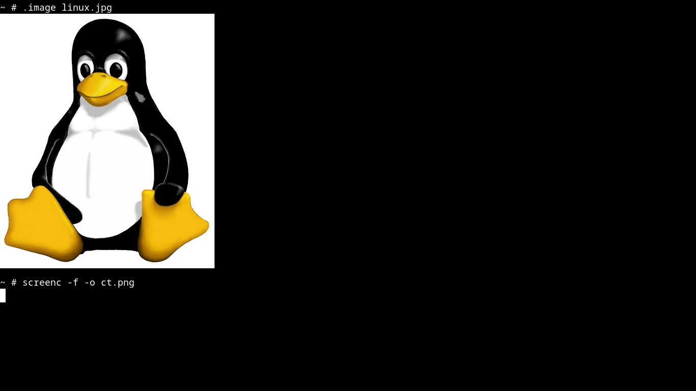

# ct



## Requirements

- C compiler, `make`, `pkg-config`, and `curl` (`make get` downloads Clay 0.14)
- X11, Xft, and FreeType development libraries
- libpng, libjpeg, and libwebp development libraries
- libmpv development library and `libutil`
- An X11 display and a usable monospace font to run

## Build

```sh
make get
make
make install
```

Use `make uninstall` to remove it. Set `PREFIX` to change the install prefix.

## View media

In the running terminal, use `.image -inline /path/to/photo.png` to place PNG,
JPEG, or WebP images inline (`.image /path/to/photo.png` remains an inline
shorthand), or `.image -focus /path/to/photo.png [...]` to open a focused image
view with optional next/previous images. Without an explicit mode, more than
five image paths opens the focus view; otherwise images stay inline. In the
focused view, `h`/`l`/`k`/`j`
or the arrow keys pan, `Shift+h`/`Shift+l` switch images, `+`/`-` zoom, `0`
resets zoom, and `Esc` or `q` closes it. `.video /path/to/video.mp4` plays
video inline.
